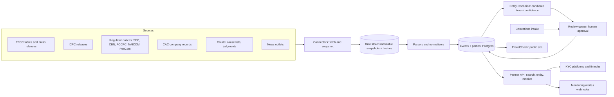

# Nigeria Public Records Layer: Implementation Plan

*As of 23 October 2026. Companion to [CONCEPT_NOTE.md](CONCEPT_NOTE.md).*
*Assumes pull requests #1 to #4 (canonical dataset, copy and legal pages, untracked database, name matching) are merged.*

This plan turns FraudCheckr from a single-source conviction explorer into a multi-source records platform, in three gated phases. Each phase ships something usable on its own, and no phase starts until the gate before it is passed.

## 1. Starting point

What exists today and carries forward:

| Asset | Where | Reused as |
| --- | --- | --- |
| Deterministic build with provenance and quality flags | `scripts/build_dataset.py`, `data/README.md` | The pattern for every new source connector |
| Canonical EFCC convictions, 2020 to 2024 | `data/convictions.csv` | First source in the new store |
| Record actions (hide / note) and corrections process | `data/record_actions.csv`, Disclaimer page | Corrections workflow, moved into the database |
| Conservative name matching with tests | `name_matching.py`, `tests/` | Matching layer of entity resolution |
| FastAPI backend, developer accounts, API keys, Paystack billing | `main.py`, `developer_platform.py` | Base for the partner API and metering |
| React frontend and legal pages | `Frontend/` | Public layer (FraudCheckr) and admin screens |
| Neon Postgres and Vercel deployment | `migrate_neon.py`, `VERCEL_DEPLOYMENT.md` | Production database and hosting |

What must change: records are stored as one JSON blob per conviction, loaded into memory, with no notion of a person or company that spans records. The core of this plan is a proper data model for parties, events and the links between them.

## 2. Principles carried over from FraudCheckr

1. **Provenance on everything.** Every fact links to the source document and the snapshot it came from.
2. **Deterministic, reproducible processing.** Re-running a connector on the same snapshot gives the same output.
3. **Flag, never guess.** Uncertain values carry a quality flag; nothing is silently "fixed".
4. **Minimise.** Victims' names, prison locations and release dates are never stored or published. New sources get the same review.
5. **Correctable by design.** Any record can be hidden, annotated or corrected, and every change is logged.
6. **Links, not identities.** A link between a record and a person always carries a confidence and the evidence for it.

## 3. Target architecture

| Component | Responsibility | Technology (proposed) |
| --- | --- | --- |
| Connectors | One module per source: fetch, snapshot, record fetch metadata | Python; scheduled jobs (GitHub Actions cron to start, a worker service later) |
| Raw store | Immutable copies of every fetched document, content-hashed | Object storage (S3-compatible) + `documents` table |
| Parsers | Turn a snapshot into normalised events and parties, with flags | Python, one parser per source format; OCR only where unavoidable |
| Store | Events, parties, links, corrections, audit log | Neon Postgres (already in use), with `pg_trgm` for name search |
| Entity resolution | Propose links between records and parties; score them | Builds on `name_matching.py`; blocking + scoring + review |
| Review queue | Humans approve uncertain links and corrections | Admin screens in the existing React app |
| Partner API | Search, entity profiles, events, monitoring webhooks | FastAPI (existing), versioned under `/v2` |
| Public site | FraudCheckr, unchanged in spirit | Existing frontend, reading from the store |

## 4. Data model

The model separates **what happened** (events) from **who it involves** (parties), joined by **links** that carry roles and confidence.

| Table | Key fields | Notes |
| --- | --- | --- |
| `sources` | id, name, kind (agency, regulator, court, media), url, terms_reviewed_at | One row per publisher |
| `documents` | id, source_id, url, fetched_at, sha256, storage_key, parser_version | Immutable raw snapshot |
| `events` | id, kind (conviction, regulator_action, court_case, media_mention), date, date_precision, jurisdiction, court_or_body, reference (charge or case number), summary, status (active, appealed, overturned), quality_flags | One fact about the world |
| `event_sources` | event_id, document_id, locator (page, row, paragraph) | Every event cites at least one document |
| `parties` | id, kind (person, organisation), display_name, created_from | A resolved person or company |
| `party_names` | party_id, name, kind (primary, alias), source_event_id | Name variants and aliases |
| `party_attributes` | party_id, attribute (address, age_at_event, rc_number), value, source_event_id, confidence | Evidence used for resolution; never national ID numbers |
| `event_parties` | event_id, party_id, role (defendant, director, respondent, subject), confidence, method, reviewed_by | The link, with how it was made |
| `company_roles` | person_party_id, org_party_id, role, from, to, source_document_id | From CAC records |
| `record_actions` | target (event or link), action (hide, note, correct), note, reason, requested_by, decided_by, dates | Replaces `data/record_actions.csv` |
| `correction_requests` | id, contact, target, claim, evidence_storage_key, status, deadlines | Drives the 5-day / 30-day commitments on the Disclaimer page |
| `audit_log` | actor, action, target, before, after, at | Every change to published data |
| `monitors` | tenant_id, party_id or query, webhook_url, created_at | For alerting |
| `tenants`, `api_keys`, `usage` | Existing developer tables, extended per tenant | Metering and billing |

## 5. Phase 0: Launch (now to month 3)

**Goal:** a live, trustworthy FraudCheckr with current data, and the foundations for more sources.

| # | Workstream | Tasks | Done when |
| --- | --- | --- | --- |
| 0.1 | Ship what exists | Merge PRs #1 to #4; refresh Neon (`migrate_neon.py --convictions-only`); decide on history purge; confirm contact details and legal commitments; lawyer review of legal pages | Live site serves 7,876 records with new pages |
| 0.2 | Multi-defendant review | Review the 139 `sentence_names_specific_defendants` records; hide or annotate via record actions | Every flagged record has a decision |
| 0.3 | Store migration | Create the tables in section 4; migrate `convictions.csv` into `events`, `parties`, `event_parties`, `event_sources`; move record actions into the database | API reads from the new tables; record IDs unchanged |
| 0.4 | EFCC and ICPC press releases | Connector per site (check robots.txt and terms first); parser extracting name, court, charge number, date, sentence; dedupe against existing events | New convictions appear within 7 days of publication |
| 0.5 | CAC company links | Confirm CAC access terms; for convictions naming companies, link to the CAC record (RC number, directors) | Organisation parties carry RC numbers where found |
| 0.6 | Corrections intake | Form on the Disclaimer page writing to `correction_requests`; admin review screen; deadline tracking | Requests acknowledged in 5 working days, decided in 30 |
| 0.7 | Engineering basics | CI running `pytest` and `build_dataset.py --check`; error monitoring; nightly database backups | Every pull request is tested automatically |
| 0.8 | Validation interviews | Interview 15 compliance officers (concept note, Validation plan) | Go / stop decision recorded |

**Gate 1:** the interviews pass the go test, and FraudCheckr has 10 active users.

## 6. Phase 1: Expand (months 3 to 9)

**Goal:** a multi-source linked record and a first paying integration.

| # | Workstream | Tasks | Done when |
| --- | --- | --- | --- |
| 1.1 | Regulator connectors | SEC Nigeria investor alerts and enforcement; CBN licence revocations; FCCPC, NAICOM, PenCom actions; procurement debarments. One connector and parser each | Each source refreshed at least weekly, with provenance |
| 1.2 | Adverse media | Ingest selected Nigerian outlets (licence or link-only, per legal advice); extract people, companies and allegation type; link as `media_mention` events, clearly separate from convictions | Mentions searchable, never presented as findings |
| 1.3 | Entity resolution v1 | Blocking by name tokens (reuse `NameIndex`), scoring on names plus attributes (company roles, address, court, dates); auto-link only above a high threshold, the rest to the review queue | Measured precision of auto-links of at least 98% on a labelled sample |
| 1.4 | Partner API v2 | `/v2/search`, `/v2/parties/{id}`, `/v2/events/{id}`, `/v2/monitors`; tenant keys, rate limits, usage metering; OpenAPI docs; sandbox data | A design partner integrates in under two weeks |
| 1.5 | Legal and compliance | Data protection impact assessment; legitimate interest assessment (GAID template); processor agreement template for KYC partners; opinion on the Credit Reporting Act | Signed off by counsel before the first paid pilot |
| 1.6 | Security | Role-based admin access; audit log on all changes; secrets management; external penetration test before partners go live | Pen test findings fixed |
| 1.7 | Commercial | Design partner agreement with one KYC platform; two fintech pilots; pricing test | Gate 2 met |

**Gate 2:** one KYC platform as design partner, and two fintechs on paid pilots.

## 7. Phase 2: Scale (months 9 to 24)

**Goal:** court data, alerts and identity partnerships that make the product hard to replace.

| # | Workstream | Tasks | Done when |
| --- | --- | --- | --- |
| 2.1 | Court data | Agreements with one or two state judiciaries and a law-report publisher; ingest cause lists and judgments; OCR pipeline with human checks for scanned documents; track the Federal High Court case-management system for public access | Civil cases (fraud, debt recovery, wind-ups) searchable for at least one major state |
| 2.2 | Monitoring alerts | Watch parties and queries; webhook and email alerts on new linked events; alert audit trail | Alerts delivered within 24 hours of ingestion |
| 2.3 | Identity partnership | Integrate one licensed verification provider; consent token passed by the partner at onboarding; match NIN or BVN-verified identity attributes to parties without storing ID numbers | Identity-backed links available to partners, consent recorded |
| 2.4 | Due-diligence reports | Company-level report generator: officers, linked events, regulator actions, media; every line cited | Reports produced in minutes, all claims sourced |
| 2.5 | Platform hardening | Move scheduled jobs to a worker service; scale Postgres; uptime and latency targets agreed with partners | Partner targets met for a full quarter |
| 2.6 | Funding | Seed raise on recurring data revenue | Gate 3 met |

**Gate 3:** recurring data-licence revenue, then raise a seed round.

## 8. Team (assumptions to confirm)

| Phase | Roles | Notes |
| --- | --- | --- |
| 0 | 1 full-stack engineer, 1 product/partnerships lead, legal adviser on call | Founders can cover product and partnerships |
| 1 | + 1 data engineer, + 1 part-time data reviewer, legal adviser on retainer | The reviewer works the resolution and corrections queues |
| 2 | + 1 engineer, + 1 partnerships/sales, + reviewers as court data grows | Court data needs more human review |

## 9. Metrics

| Area | Metric | Target (to confirm) |
| --- | --- | --- |
| Freshness | Days from a source publishing to the event appearing | 7 days in Phase 0, 2 days in Phase 1 |
| Accuracy | Precision of automatic links on a labelled sample | At least 98% |
| Corrections | Requests acknowledged / decided on time | 100% within 5 working days / 30 days |
| Coverage | Sources live; events and parties held | Grows each phase; reported monthly |
| Usage | Active public users; partner API calls | 10 users at Gate 1; partner volume from Phase 1 |
| Revenue | Paid pilots; recurring licence revenue | 2 pilots at Gate 2; recurring revenue at Gate 3 |

## 10. Dependencies and open decisions

- **Before Phase 0 ends:** lead entity; lawyer appointed; confirmed contact details and legal-page commitments; history purge decision; decision on the 139 multi-defendant records.
- **Before Phase 1 starts:** terms of use reviewed for every planned source; CAC data access route; first design-partner conversation.
- **Before Phase 2 starts:** court data agreements; identity provider selected; Credit Reporting Act position.
